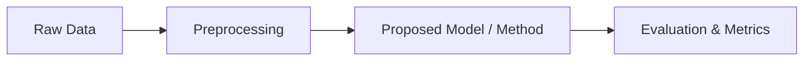

# Research Methodology

## 1. Problem Statement & Objectives
- **Problem Statement:** `[Clearly define what problem you are solving and why existing solutions are insufficient]`
- **Main Goal / Hypothesis:** `[What does your proposed method do differently, and what improvement do you expect?]`

---

## 2. Proposed Approach

- **Overview:** `[Brief summary of your approach]`
- **Key Components:**
  1. `[Component 1: e.g., Data cleaning & feature extraction]`
  2. `[Component 2: e.g., Core model or algorithm]`
  3. `[Component 3: e.g., Post-processing or decision logic]`

---

## 3. Dataset & Baselines

### Dataset
- **Dataset Name & Source:** `[Name / Link]`
- **Size & Format:** `[e.g., 10,000 samples, text/images/tabular]`
- **Split:** `[e.g., 80% Train, 10% Validation, 10% Test]`

### Baselines for Comparison
| Baseline | Description | Why Included |
| :--- | :--- | :--- |
| **Baseline 1** | `[Simple / standard baseline]` | Sanity check |
| **Baseline 2** | `[Current state-of-the-art / popular model]` | Direct performance comparison |

---

## 4. Evaluation & Metrics
- **Primary Metric:** `[e.g., Accuracy, F1-score, MAE]` ($\uparrow$ Higher is better)
- **Secondary Metric:** `[e.g., Latency, Model size, Memory footprint]` ($\downarrow$ Lower is better)
- **Validation Method:** `[e.g., 5-fold cross-validation / Fixed test set with 3 random seeds]`

---

## 5. Experiment Checklist
- [ ] Baseline models implemented and evaluated
- [ ] Proposed model trained and tested on identical data splits
- [ ] Ablation study conducted (testing individual components)
- [ ] Results and error cases documented in `research/experiment-result.md`
